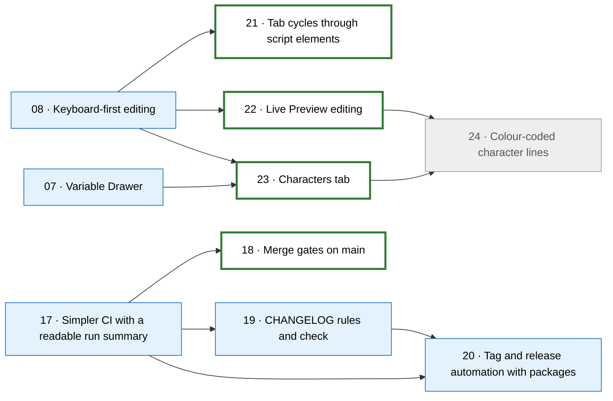

# Plan 2: Delivery pipeline and editor experience

Phase 1 spec: [SPEC.md](SPEC.md) · Phase 1 plan: [PLAN.md](PLAN.md) · Tickets: [tickets/](tickets/) (numbering continues from 17)

This plan adds two tracks on top of Phase 1. It doesn't replace [PLAN.md](PLAN.md): the Phase 1 tickets (09, 10, 12, 13, 15, 16) are still open and can run alongside.

- **Track A, delivery pipeline (tickets 17–20):** a simpler CI, a readable run summary, merge gates on `main`, CHANGELOG rules, and releases with installable packages attached.
- **Track B, editor experience (tickets 21–24):** Tab cycles through script elements, Live Preview editing, a Characters tab, and colour-coded character lines.

## How this plan stays current

Same as [PLAN.md](PLAN.md): ticket frontmatter is the source of truth and the block below is generated by `node scripts/plan.mjs`. A ticket belongs to this document because its frontmatter has `plan: PLAN-2.md` (tickets without a `plan` field belong to `PLAN.md`). Blockers from the other plan are drawn in the chart but not listed in the table.

<!-- plan:start (generated by scripts/plan.mjs — do not edit by hand) -->

**Progress:** 3/8 tickets complete.



| | # | Ticket | Model | Blocked by | Criteria | State |
|---|---|---|---|---|---|---|
| [x] | 17 | [Simpler CI with a readable run summary](tickets/17-ci-simplification-and-summary.md) | sonnet | — | 3/6 | 📱 needs-device |
| [ ] | 18 | [Merge gates on main](tickets/18-repo-merge-gates.md) | haiku | 17 | 0/4 | 🟢 ready |
| [x] | 19 | [CHANGELOG rules and check](tickets/19-changelog-rules.md) | sonnet | 17 | 5/6 | 📱 needs-device |
| [x] | 20 | [Tag and release automation with packages](tickets/20-release-automation.md) | sonnet | 17, 19 | 4/8 | 📱 needs-device |
| [ ] | 21 | [Tab cycles through script elements](tickets/21-tab-cycles-elements.md) | sonnet | 08 | 0/8 | 🟢 ready |
| [ ] | 22 | [Live Preview editing](tickets/22-live-preview-editing.md) | sonnet | 08 | 0/8 | 🟢 ready |
| [ ] | 23 | [Characters tab](tickets/23-characters-tab.md) | sonnet | 07, 08 | 0/8 | 🟢 ready |
| [ ] | 24 | [Colour-coded character lines](tickets/24-character-colour-coding.md) | sonnet | 22, 23 | 0/9 | ⛔ blocked |

Legend: ✅ done · 📱 code done, waiting for on-device check · 🚧 in progress · 🟢 ready to start · ⛔ blocked

<!-- plan:end -->

## Agent rules

The [Agent rules in PLAN.md](PLAN.md#agent-rules-every-ticket) apply to every ticket here, with one addition once ticket 19 is merged: follow the CHANGELOG rules in `CLAUDE.md`.

## Suggested order

Track A and Track B don't touch the same files, so one ticket from each can run at the same time.

- **Track A:** 17 first. Then 18 and 19 in either order. 20 last.
- **Track B:** 21 and 22 both edit `src/ui/editing.ts`, so run them one after the other (21 first: it's small). 23 can run next to either. 24 last.
- Do Track A's 17–19 before starting more feature tickets: every later PR then gets the gate and the CHANGELOG check for free.

---

## Spec: Track A, delivery pipeline

### Problem

- CI has two jobs that repeat the same setup, install dependencies twice and build the web app twice. A run's result is a green or red tick with nothing to read.
- `main` requires a pull request but **no status check**, so a PR with failing CI can be merged.
- `CHANGELOG.md` is out of date. PRs #7, #8, #19, #20, #21, #22, #23, #24 and #25 have no entry, because nothing tells an agent to add one and nothing checks.
- There are no tags or releases. The only installable build is a CI artifact that expires, signed with a throwaway debug key, so each build can't be installed over the previous one without uninstalling (which deletes the app's private data: the recovery journal, recent files, and snapshots in single-file mode).
- The app version is written in two places that disagree (`package.json` says 0.1.0, `android/app/build.gradle` says 1.0).

### User stories

68. As the owner, I want one CI job with one name, so that there's one thing to read and one thing to require.
69. As the owner, I want each CI run to show a summary (which checks ran, test counts, APK size and checksum, plan progress), so that I can judge a PR from my phone without opening logs.
70. As the owner, I want `main` to refuse a merge unless CI passed, so that a broken build can't land.
71. As the owner, I want one command that runs locally exactly what CI runs, so that agents find failures before pushing.
72. As the owner, I want written CHANGELOG rules that Claude follows on every PR, and a check that fails when an entry is missing, so that the changelog is always complete.
73. As the owner, I want a release cut by merging one "release" PR, so that tagging, release notes and package builds need no manual steps.
74. As the owner, I want each release to carry a signed APK that installs over the previous release, so that updating the Boox never loses data.
75. As the owner, I want release notes taken from the CHANGELOG, so that I write them once.

### Decisions

- **D5: one workflow, one job, named `ci`.** Steps in order: install, `npm run check`, build the APK, upload it, write the summary. The job name is what the ruleset requires, so it must not be renamed without updating the ruleset.
- **D6: `npm run check` is the single definition of "the checks".** It runs typecheck, lint, tests, `plan.mjs --check` and (after ticket 19) the changelog check. CI calls it; agent rule 5 calls it.
- **D7: gates live in the existing `main` ruleset, not in workflow logic.** Add a required status check (`ci`), keep "require a pull request", and allow squash merges only (every merge so far is a squash; one commit per PR is what the CHANGELOG and release tooling assume). No required reviews: this is a one-person repo.
- **D8: the version lives in `package.json` only.** Gradle reads `versionName` from it and computes `versionCode = major × 10000 + minor × 100 + patch`.
- **D9: a release is a merged PR that changes the version.** `npm run release:prepare -- <patch|minor|major>` bumps the version and turns `[Unreleased]` into a dated section; that goes up as a normal PR. When it merges, a release workflow sees a version with no matching tag, creates tag `vX.Y.Z` and the GitHub Release. Nobody pushes tags by hand (and `main` can't be pushed to directly anyway).
- **D10: release packages are a release-signed APK, its SHA-256 file, and a zip of the web build.** The signing key is created once by the owner and stored as repository secrets. If the secrets are missing the release fails with a clear message; it never falls back to a debug key.
- **D11: CHANGELOG rules** (ticket 19 puts these in `CLAUDE.md` and enforces what a script can check):
  1. Every PR adds exactly one line under `## [Unreleased]`, in the right Keep a Changelog section (Added, Changed, Deprecated, Removed, Fixed, Security). A PR that truly does two unrelated things may add two.
  2. Write for the person using the app or the repo, not for the code: say what is different now. One sentence, starting with a capital, no trailing full stop. A ticket PR's line under *Added* is the ticket title.
  3. End the line with the PR link: `([#N](https://github.com/mikebgio/eink-screenplay-writer/pull/N))`. Open the PR first to get the number, then add the line and push.
  4. Add new lines at the bottom of their section. Never reorder, reword or delete someone else's line, and never edit a released section.
  5. No entry is needed when the PR only changes tickets, plan documents or comments, or only ticks owner-check criteria. Give such a PR the `no-changelog` label. Dependabot PRs are exempt automatically; the release script adds one "Update dependencies" line that links them.
  6. Don't touch version numbers, dated section headings or the link references at the bottom of the file. `npm run release:prepare` owns those.
  7. No AI attribution in entries.

### Out of scope (Track A)

Play Store publishing, an AAB build, automatic semantic versioning from commit messages, required reviewers, deploying the web build anywhere.

---

## Spec: Track B, editor experience

### Problem

- Tab only does something on an empty line, and only switches between two modes. Changing a line you've already typed needs one of eight Ctrl+number shortcuts, which is hard to remember.
- The editor shows raw Fountain: forcing marks (`.`, `@`, `>`), emphasis asterisks and `{{KEY}}` are always visible, and the indents are only a rough hint. To see the real layout you need the print view, which costs half the screen.
- Characters exist only as text in cues. There's nowhere to see the cast, describe a character, or rename one everywhere.
- In a long dialogue scene it's hard to see at a glance who is speaking, or to follow one character through the script.

### User stories

76. As a keyboard user, I want Tab to change the current line to the next element type and Shift+Tab to the previous one, on a line with text as well as an empty one, so that I can fix a line's type without learning eight shortcuts.
77. As a keyboard user, I want to see which element type the cursor line is, so that I know where I am in the Tab cycle.
78. As a writer, I want Tab to give me back exactly what I typed if I cycle all the way round, so that cycling never damages my text.
79. As a writer, I want a Live Preview editing mode where the editor is laid out like the printed page (indents, capitals, emphasis) and Fountain markup is hidden, so that I write in something close to the final script without the print view.
80. As a writer, in Live Preview I want the markup of the line I'm on to reappear, so that I can always see and edit the real text of the file.
81. As a writer, in Live Preview I want `{{KEY}}` shown as its value except where my cursor is, so that the text reads as it will print.
82. As a writer, I want to switch between Live Preview and Source at any time without losing my place or my undo history, so that I can drop to raw text when I need to.
83. As a writer, I want a Characters tab listing everyone who speaks, with how much they say and where they first appear, so that I can see the cast.
84. As a writer, I want to give a character a description and notes, so that I can keep who they are next to the script.
85. As a writer, I want to rename a character in one place and have every cue updated, so that a name change is one edit.
86. As a writer, I want character definitions stored inside the `.fountain` file, so that they travel with the script like variables do.
87. As a writer, I want to give a character a colour and see their cues and dialogue marked with it in the editor, so that I can tell speakers apart at a glance.
88. As a writer, I want to highlight just one or a few characters and leave the rest plain, so that I can follow one character through the script.
89. As an e-ink user, I want each colour to come with a non-colour mark as well, so that the coding still works in greyscale and on the Kaleido screen's weak colour (story 59).

### Decisions

- **D12: Tab cycles the element type of the cursor line.** This replaces the Tab table in ticket 08 (which only acted on empty lines). The order depends on where the line is, because dialogue only exists under a cue:
  - A line that starts a block (first line, or after a blank line): action → scene heading → character → transition → action.
  - A line directly under a cue, parenthetical or dialogue: dialogue → parenthetical → dialogue.
  - Shift+Tab goes the other way. An open autocomplete list still takes Tab first. Ctrl+1…8 stay as they are.
- **D13: "Live Preview" means the Obsidian sense: one editor, still editing the Fountain text, drawn formatted.** It is not editing inside the paged print view. Markup is hidden with CodeMirror decorations and shown again for the element under the cursor or selection. The file's bytes are identical in either mode. The print view stays the only place with real pages.
- **D14: Live Preview is a mode of the existing editor (Source ⇄ Live Preview), not a new layout.** It's on by default, remembered per device, and toggled with `Ctrl+.`. The editor is not re-created when switching.
- **D15: character definitions are title-page entries, like variables (D3).** One entry per character, `Char-NAME:`, where the first line of the value is the colour name (or `none`) and any indented lines after it are the description:

  ```
  Char-JACK: blue
      Ex-teacher, mid-40s. Hasn't slept.
  ```

  NAME is the cue identity from ticket 07 (so a character played by a variable is `Char-{{HERO}}`). A character needs no entry to be listed; an entry is written only once a colour or description is set.
- **D16: the Characters tab lives in the existing drawer.** The drawer gets two tabs, Variables and Characters. `Ctrl+D` opens it on the last-used tab; `Ctrl+Shift+C` opens it on Characters.
- **D17: a fixed palette of eight colours, each paired with a pattern.** A coloured line gets a thick bar in the left margin whose pattern (solid, dashed, dotted, double and so on) is unique per palette slot, so two characters are distinguishable in greyscale. No background tints behind text: on Kaleido 3 they lower contrast and ghost. Colour appears in the editor and, optionally, the on-screen print view; **never** in PDF, FDX or Fountain exports.

### Out of scope (Track B)

Editing inside the paged print view. Character bios beyond a free-text description (Phase 2 keeps structured bios, the corkboard and colour-coded *storylines*). Custom colours outside the palette. Coloured "sides" exports for actors. Changing what Enter does.

---

## Decision log

Decisions D5–D17 are in the two spec sections above. Add later decisions here, numbered from D18.
