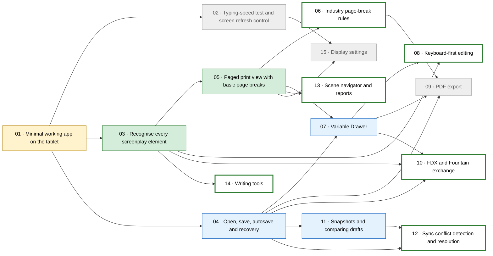

# Plan: Boox Screenplay Writer — Phase 1

Spec: [SPEC.md](SPEC.md) · Tickets: [tickets/](tickets/)

## How this plan stays current

The **ticket files are the single source of truth.** Each ticket starts with a frontmatter block:

```yaml
---
id: 07
title: Variable Drawer
status: todo          # todo | in-progress | needs-device | done
blocked_by: [04, 05]
model: sonnet         # sonnet | haiku: the cheapest model that can do it well
---
```

The status section below is **generated** from those blocks. Don't edit it by hand. Instead run:

```bash
node scripts/plan.mjs
```

Other commands:

```bash
node scripts/plan.mjs --next
```

Lists the tickets you can start now (every blocker is `done` or `needs-device`).

```bash
node scripts/plan.mjs --check
```

Fails if this file is out of date (useful in a pre-commit hook later).

The progress count in each ticket comes from its acceptance-criteria checkboxes (`- [ ]` → `- [x]`).

<!-- plan:start (generated by scripts/plan.mjs — do not edit by hand) -->

**Progress:** 5/15 tickets complete.



| | # | Ticket | Model | Blocked by | Criteria | State |
|---|---|---|---|---|---|---|
| [ ] | 01 | [Minimal working app on the tablet](tickets/01-walking-skeleton.md) | sonnet | — | 5/7 | 🚧 in-progress |
| [ ] | 02 | [Typing-speed test and screen refresh control](tickets/02-eink-refresh-and-latency-spike.md) | sonnet | 01 | 0/7 | ⛔ blocked |
| [x] | 03 | [Recognise every screenplay element](tickets/03-full-fountain-parsing.md) | sonnet | 01 | 8/8 | ✅ done |
| [x] | 04 | [Open, save, autosave and recovery](tickets/04-storage-open-save-autosave.md) | sonnet | 01 | 3/7 | 📱 needs-device |
| [x] | 05 | [Paged print view with basic page breaks](tickets/05-paged-print-view.md) | sonnet | 03 | 7/7 | ✅ done |
| [ ] | 06 | [Industry page-break rules](tickets/06-industry-page-break-rules.md) | sonnet | 05 | 0/5 | 🟢 ready |
| [x] | 07 | [Variable Drawer](tickets/07-variable-drawer.md) | sonnet | 04, 05 | 3/8 | 📱 needs-device |
| [ ] | 08 | [Keyboard-first editing](tickets/08-keyboard-first-editing.md) | sonnet | 03, 07 | 0/6 | 🟢 ready |
| [ ] | 09 | [PDF export](tickets/09-pdf-export.md) | sonnet | 04, 06, 07 | 0/6 | ⛔ blocked |
| [ ] | 10 | [FDX and Fountain exchange](tickets/10-fdx-and-fountain-exchange.md) | sonnet | 03, 04, 07 | 0/6 | 🟢 ready |
| [x] | 11 | [Snapshots and comparing drafts](tickets/11-snapshots-and-diff.md) | sonnet | 04 | 4/6 | 📱 needs-device |
| [ ] | 12 | [Sync conflict detection and resolution](tickets/12-sync-conflicts.md) | sonnet | 04, 11 | 0/4 | 🟢 ready |
| [ ] | 13 | [Scene navigator and reports](tickets/13-navigator-and-reports.md) | haiku | 05 | 0/6 | 🟢 ready |
| [ ] | 14 | [Writing tools](tickets/14-writing-tools.md) | sonnet | 03 | 0/5 | 🟢 ready |
| [ ] | 15 | [Display settings](tickets/15-display-settings.md) | haiku | 02, 05 | 0/8 | ⛔ blocked |

Legend: ✅ done · 📱 code done, waiting for on-device check · 🚧 in progress · 🟢 ready to start · ⛔ blocked

<!-- plan:end -->

## Agent rules (every ticket)

1. **Read** `SPEC.md`, your ticket, and the *Handoff notes* of every ticket listed in `blocked_by`.
2. **Claim it:** set `status: in-progress` in the ticket's frontmatter, then run `node scripts/plan.mjs`.
3. **Work test-first through the seams in the spec:** the Script Engine (pure; no DOM, I/O or Capacitor) and the Storage port (tested with `MemoryStorage`). Test behaviour, not internals.
4. Tick each acceptance criterion (`- [x]`) as you meet it. Criteria marked **(device)** or **(manual)** need the owner on the Boox or the Mac. Don't tick them yourself; list them under Handoff notes as "Owner checks".
5. **Before finishing:** run `npm test`, `npm run typecheck` and `npm run lint`; all must pass.
6. Write **Handoff notes** in the ticket: decisions, API names and quirks later tickets need.
7. **Set the status:**
   - `done` if every criterion is ticked
   - `needs-device` if only (device) or (manual) checks remain; this still unblocks the tickets that depend on it

   Then run `node scripts/plan.mjs`.
8. **Commit** with the message `NN: <ticket title>`. **Don't add `Co-Authored-By` or any other AI attribution lines.** Don't push unless asked.
9. **Don't revisit decisions** written in the spec or the ticket. If one turns out to be wrong, stop, explain why in Handoff notes, and ask the owner.
10. **Use cheaper models where they fit:** a ticket marked `model: haiku`, or a step marked *Haiku-suitable*, can be handed to a Haiku subagent. Check its output in the main session.

## Suggested order

Ticket 01 first. Then 02, 03 and 04 can run **in parallel**. Ticket 02 is a **go/no-go gate**: if typing is too slow on e-ink, stop and re-plan before building more UI (see ticket 02). After that, take any ticket that `--next` lists. Ticket 06 (page-break rules) is the riskiest logic, so don't save it for last.

## Decision log

Decisions made after the spec was written. Add new entries at the bottom.

- **D1 (2026-11-12): files are opened in one of two ways.** The preferred way is a *workspace folder*: the writer picks a folder once and the app keeps access to it, which allows a snapshots folder next to the script and a list of the folder's files. The fallback is *single file*: the writer picks one file, and snapshots are kept on the device only. The reason: Android's file picker can only create files next to the script when it has access to the whole folder, and it's unclear whether the Google Drive app offers folder access. Ticket 04 checks this on the device.
- **D2 (2026-11-12): the file version is a SHA-256 of its contents, not its modified time.** Storage backends like Drive don't report modified times reliably. Conflict detection (ticket 12) re-reads the file and compares hashes before every save.
- **D3 (2026-11-12): the UI uses Preact; PDFs use pdf-lib with fontkit and the bundled Courier Prime font.** Variables are stored as `Var-KEY: value` title-page entries.
